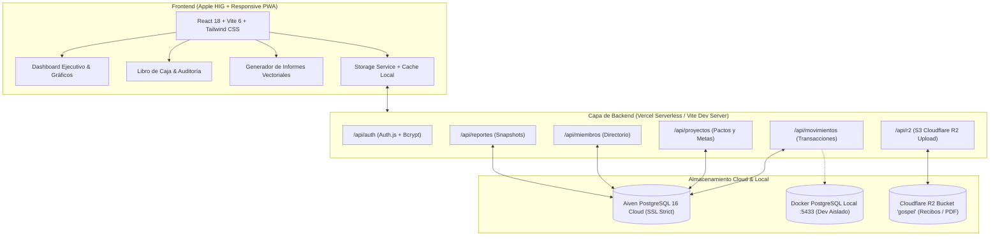

<div align="center">

# ⛪ Sistema de Flujo de Efectivo Eclesiástico 💰

### *Plataforma de Tesorería, Mayordomía Financiera y Rendición de Cuentas para Iglesias y Ministerios*

[](package.json)
[](https://react.dev/)
[](https://www.typescriptlang.org/)
[](https://vitejs.dev/)
[](https://tailwindcss.com/)
[-4169E1.svg?style=for-the-badge&logo=postgresql&logoColor=white)](https://aiven.io/)
[](https://www.cloudflare.com/products/r2/)
[](https://developer.apple.com/design/human-interface-guidelines)
[](LICENSE)
[](.github/workflows/ci.yml)

> *"Procurando hacer las cosas honradamente, no sólo delante del Señor sino también delante de los hombres."*  
> — **2 Corintios 8:21**

</div>

---

## 📑 Tabla de Contenidos

- [Visión General & Resumen Ejecutivo](#-visión-general--resumen-ejecutivo)
- [Arquitectura del Sistema](#-arquitectura-del-sistema)
- [Módulos Principales](#-módulos-principales)
  - [1. Dashboard Ejecutivo Apple HIG](#1-dashboard-ejecutivo-apple-hig)
  - [2. Libro Diario de Caja & Auditoría Mensual](#2-libro-diario-de-caja--auditoría-mensual)
  - [3. Captura Ágil de Entradas (Modo Sobres & Split Diezmo-Pacto)](#3-captura-ágil-de-entradas-modo-sobres--split-diezmo-pacto)
  - [4. Registro de Egresos & Comprobantes en Cloudflare R2](#4-registro-de-egresos--comprobantes-en-cloudflare-r2)
  - [5. Proyectos Pactados & Metas de Fe](#5-proyectos-pactados--metas-de-fe)
  - [6. Directorio Integral de Hermanos](#6-directorio-integral-de-hermanos)
  - [7. Generador Oficial de Informes con Auditoría Histórica](#7-generador-oficial-de-informes-con-auditoría-histórica)
  - [8. Experiencia Móvil de Élite (iOS Tab Bar & Touch Targets)](#8-experiencia-móvil-de-élite-ios-tab-bar--touch-targets)
- [Stack Tecnológico](#-stack-tecnológico)
- [Instalación y Despliegue](#-instalación-y-despliegue)
  - [Prerrequisitos](#prerrequisitos)
  - [Configuración de Variables de Entorno](#configuración-de-variables-de-entorno)
  - [Desarrollo Local Aislado con Docker](#desarrollo-local-aislado-con-docker)
  - [Scripts Disponibles](#scripts-disponibles)
- [Esquema de Base de Datos Relacional](#-esquema-de-base-de-datos-relacional)
- [Seguridad, Confidencialidad y Respaldos](#-seguridad-confidencialidad-y-respaldos)
- [Estándares Comunitarios](#-estándares-comunitarios)
- [Licencia](#-licencia)

---

### 📌 Punto de Referencia de Versión

| Versión | Fecha y Hora (UTC-6) | Responsable | Estado |
| :--- | :--- | :--- | :--- |
| **v1.10.0** | 2026-11-02 00:35:00 | David Méndez | Producción / Estable |
| **v1.9.0** | 2026-11-01 22:15:00 | David Méndez | Producción / Estable |
| **v1.8.2** | 2026-10-13 11:15:00 | David Méndez | Producción / Estable |
| **v1.8.1** | 2026-10-11 10:51:00 | David Méndez | Producción / Estable |
| **v1.8.0** | 2026-10-11 09:58:00 | David Méndez | Producción / Estable |
| **v1.7.0** | 2026-09-29 21:26:00 | David Méndez | Producción / Estable |
| **v1.6.0** | 2026-09-29 13:35:00 | David Méndez | Producción / Estable |
| **v1.5.0** | 2026-09-29 13:14:00 | David Méndez | Producción / Estable |
| **v1.4.1** | 2026-09-29 12:16:00 | David Méndez | Producción / Estable |
| **v1.4.0** | 2026-09-29 12:10:00 | David Méndez | Producción / Estable |

---

## 📖 Visión General & Resumen Ejecutivo

El **Sistema de Flujo de Efectivo Eclesiástico** es una solución full-stack creada para transformar y dignificar la administración de recursos en iglesias cristianas, misiones y congregaciones. Combina el rigor contable de la partida doble y la mayordomía con una experiencia visual de élite inspirada en las **Human Interface Guidelines (HIG) de Apple**.

### Pilares Fundamentales:
- **Separación Fiel de Fondos:** Distinción matemática estricta entre la **Caja General Operativa** (diezmos y ofrendas para gastos corrientes del templo) y los **Fondos Comprometidos de Proyectos Pactados** (fondos etiquetados para templos, bocinas o misiones), impidiendo que se mezclen o gasten indebidamente.
- **Trazabilidad & Comprobantes en la Nube:** Cada egreso se respalda con su comprobante digital fiscal (JPG, PNG o PDF) almacenado en **Cloudflare R2 Bucket (`gospel`)**, visualizable al instante con Lightbox y anexo documental numerado.
- **Auditoría e Inmutabilidad Histórica:** Registro de informes oficiales en *snapshots* inmutables con folios serializados. Si algún movimiento pasado sufre una modificación posterior, el sistema detecta y expone la diferencia en un panel de auditoría.
- **Confidencialidad Congregacional:** Protección estricta de la privacidad de los hermanos diezmantes, presentándolos de forma anónima/confidencial en reportes ministeriales públicos.

---

## 🏗️ Arquitectura del Sistema

La arquitectura está construida con desacoplamiento total, alta disponibilidad en la nube y resiliencia offline/local:



---

## 💎 Módulos Principales

### 1. Dashboard Ejecutivo Apple HIG
- **4 Pilares Financieros Clave:** Tarjetas unificadas para **Caja Operativa Corriente**, **Ingresos Totales Recaudados**, **Egresos Totales** y **Fondo Restringido de Proyectos**.
- **Gráfica de Barras Mensual (Entradas vs Gastos):** Representación tipo cápsula mensual interactiva con cálculo de solvencia y tooltips de cristal líquido (*Glassmorphism*).
- **Anillo Donut Dinámico de Aportes:** Gráfico circular con arcos graduados en gradientes Apple (`Indigo` para Diezmos, `Emerald` para Ofrendas, `Amber` para Proyectos) y espaciado de seguridad sin colisiones de trazo. Incluye barra de proporción continua y lista agrupada interactiva.
- **Rendimiento por Día de Culto:** Comparativa simétrica y visual entre cultos de **Miércoles** y **Domingo** con desglose por tipo de aporte y porcentaje de captación.
- **Proyectos en Curso:** Monitoreo visual de avance de metas con cálculo de porcentaje y valor semanal sugerido.

### 2. Libro Diario de Caja & Auditoría Mensual
- **Auditoría Cronológica Continua:** Visualización de cada transacción con su saldo acumulado en caja posterior a cada movimiento.
- **Reclasificación Inline de Categorías:** Selector desplegable directo en la tabla con micro-loader reactivo para actualizar categorías de gastos o ingresos con persistencia inmediata en PostgreSQL.
- **Mover Fecha en Movimientos:** Selector de fecha con detección de día de culto y accesos de 1 toque (`Hoy`, `Último Domingo`, `Último Miércoles`).
- **Vista de Tarjetas Táctiles en Móviles:** En pantallas pequeñas, la tabla de 9 columnas se transforma automáticamente en tarjetas agrupadas estilo Apple Wallet sin alterar la vista de escritorio.
- **Cierres Mensuales y Saldos por Mes:** Módulo de auditoría periódica que calcula **Saldo Inicial**, **Entradas (+)**, **Gastos (-)**, **Flujo Neto (+/-)** y **Saldo Final al Cierre** de cada mes con exportación a CSV.

### 3. Captura Ágil de Entradas (Modo Sobres & Split Diezmo-Pacto)
- **Hero Amount Display:** Entrada numérica de gran formato estilo Apple Cash con botones discretos para montos rápidos (`+$50`, `+$100`, `+$200`, `+$500`, `+$1000`).
- **Modo Continuo de Sobres:** Permite contar y procesar decenas de sobres de fidelidad de manera ágil sin salir del formulario.
- **Mecanismo de Split Diezmo a Pacto:** Permite al tesorero tomar una porción de un sobre de diezmo para abonar al compromiso de fe de un proyecto pactado. El sistema genera de forma balanceada:
  1. El Diezmo en Caja General por el importe neto.
  2. El Aporte al Proyecto Pactado con vinculación al miembro.

### 4. Registro de Egresos & Comprobantes en Cloudflare R2
- **Carga Directa a Object Storage:** Arrastra o selecciona recibos de luz, agua, mantenimiento o viáticos (JPG, PNG, WebP o PDF).
- **Compresión y Seguridad:** Carga asíncrona a Cloudflare R2 con cálculo de peso en KB y previsualización Lightbox en pantalla completa.
- **Asignación Opcional a Proyectos:** Permite que un gasto se aplique directamente a los fondos de una obra específica.

### 5. Proyectos Pactados & Metas de Fe
- **Gestión Integral de Proyectos:** Creación de obras (ej. *"Adquisición de Bocinas"*, *"Construcción Templo"*) con meta financiera y cuota sugerida.
- **Registro de Hermanos Pactantes:** Ficha por creyente con cuota acordada, semanas pagadas, semanas estimadas y saldo restante.
- **Historial Completo de Entregas:** Subvista dedicada de entregas por fecha con capacidad de editar montos, recibos o eliminar entregas recalculando balances al instante.
- **Liquidación con Traspaso Contable Neutral:** Al concluir una meta con remanente no utilizado, el sistema permite transferir el saldo sobrante a la Ofrenda General con balance neto neutral ($0.00 de discrepancia contable).

### 6. Directorio Integral de Hermanos
- **Ficha Ministerial:** Base de datos de feligreses con número de teléfono, notas pastorales y estado activo/inactivo.
- **Métricas de Fidelidad:** Conteo total histórico de diezmos aportados y aportes a proyectos pactados.
- **Integración con WhatsApp:** Botón directo (`wa.me`) para enviar confirmaciones o recibos de fidelidad con 1 clic.
- **Selector Inteligente con Portal React:** Autocompletado rápido al capturar diezmos o registrar pactos.

### 7. Generador Oficial de Informes con Auditoría Histórica
- **Formato Carta Vectorizado (`@media print`):** Estado de cuenta imprimible o exportable a PDF con membrete eclesiástico indestructible, tablas a ancho fijo y bloque ministerial para 4 firmas (Pastor Principal, Secretario General, Tesorero General y Comité de Auditoría).
- **Snapshots Inmutables:** Guarda la fotografía exacta de lo que se presentó a la asamblea en una tabla relacional histórica con folio único serializado (`TES-YYYYMM-XXXX`).
- **Detección de Cambios Posteriores:** Si después de generar un reporte alguien modifica un movimiento del período, el visor histórico alerta de forma destacada los cambios posteriores detectados.
- **Anexo Documental de Evidencias:** Compila y numera todas las facturas y recibos del período con referencia cruzada en la tabla de egresos.

### 8. Experiencia Móvil de Élite (iOS Tab Bar & Touch Targets)
- **Barra de Pestañas Inferior Fija (iOS Bottom Tab Bar):** Navegación ergonómica al alcance del pulgar con efecto vidrio esmerilado y respeto de safe-area (`env(safe-area-inset-bottom)`).
- **Dock Flotante Anticolisión:** El botón de acciones rápidas flota por encima de la barra móvil de navegación sin solaparse.
- **Áreas Táctiles Estándar:** Todos los botones interactivos cumplen con el estándar mínimo de 44x44px.

---

## 💻 Stack Tecnológico

| Capa | Tecnologías |
| :--- | :--- |
| **Frontend Framework** | [React 18.3](https://react.dev/) + [TypeScript 5.8](https://www.typescriptlang.org/) |
| **Bundler & Tooling** | [Vite 6.2](https://vitejs.dev/) |
| **Estilos & UI** | [Tailwind CSS 3.4](https://tailwindcss.com/) + Apple Human Interface Guidelines (HIG) |
| **Iconografía** | [Lucide React](https://lucide.dev/) (Iconos limpios y optimizados) |
| **Backend & APIs** | Vercel Serverless Functions (`@vercel/node`) / Dev Middleware en Vite |
| **Base de Datos** | [PostgreSQL 16](https://www.postgresql.org/) hospedado en [Aiven Cloud](https://aiven.io/) con SSL |
| **Object Storage** | [Cloudflare R2](https://www.cloudflare.com/products/r2/) con API compatible con S3 (`@aws-sdk/client-s3`) |
| **Autenticación** | [Auth.js (@auth/core)](https://authjs.dev/) + [Bcryptjs](https://www.npmjs.com/package/bcryptjs) |
| **Contenerización** | [Docker](https://www.docker.com/) & Docker Compose para base local de pruebas |

---

## 🚀 Instalación y Despliegue

### Prerrequisitos
- **Node.js**: `v18.0.0` o superior (Recomendado `v20 LTS`).
- **pnpm**: `v9.0.0` o superior (o `npm`).
- **Docker**: (Opcional, para desarrollo con PostgreSQL local).

### Configuración de Variables de Entorno
1. Clona el repositorio:
   ```bash
   git clone https://github.com/DEMG-DEV/RGDev.App.FlujoEfectivo.git
   cd RGDev.App.FlujoEfectivo
   ```
2. Crea tu archivo de variables a partir de la plantilla:
   ```bash
   cp .env.example .env
   ```
3. Configura las credenciales requeridas en `.env` (Base de datos PostgreSQL, Auth.js y Cloudflare R2).

### Desarrollo Local Aislado con Docker
Para programar sin afectar la base de datos de producción de Aiven, utiliza la infraestructura Docker incluida:

```bash
# 1. Levantar contenedor de PostgreSQL local en puerto 5433
pnpm docker:up

# 2. Iniciar el servidor local apuntando al contenedor
pnpm dev:local

# 3. (Opcional) Respaldar producción y restaurar en tu base local:
pnpm docker:backup   # Descarga copia de lectura desde Aiven
pnpm docker:restore  # Restaura la copia en tu PostgreSQL local
```

### Scripts Disponibles

| Comando | Descripción |
| :--- | :--- |
| `pnpm dev` | Inicia el servidor de desarrollo de Vite con recarga rápida (HMR). |
| `pnpm dev:local` | Inicia Vite configurado para conectar a PostgreSQL en Docker local (`:5433`). |
| `pnpm build` | Ejecuta la verificación estricta de TypeScript (`tsc -b`) y compila para producción. |
| `pnpm preview` | Previsualiza localmente la compilación de producción de `dist/`. |
| `pnpm docker:up` | Inicia el contenedor PostgreSQL de desarrollo local en segundo plano. |
| `pnpm docker:down` | Detiene y remueve los contenedores de desarrollo local. |
| `pnpm docker:backup` | Genera un dump SQL de solo lectura de la base de datos de producción. |
| `pnpm docker:restore` | Aplica el dump de respaldo sobre el PostgreSQL local en Docker. |
| `pnpm backup:r2` | Ejecuta el script automatizado para respaldar la base de datos directamente en Cloudflare R2. |

---

## 🗄️ Esquema de Base de Datos Relacional

El modelo de datos relacional garantiza la integridad referencial y auditoría estricta:

```
┌─────────────────────────────────┐       ┌─────────────────────────────────┐
│        miembros_iglesia         │       │       proyectos_pactados        │
├─────────────────────────────────┤       ├─────────────────────────────────┤
│ id (UUID, PK)                   │◄──┐   │ id (UUID, PK)                   │◄──┐
│ nombre (VARCHAR)                │   │   │ nombre (VARCHAR)                │   │
│ telefono (VARCHAR)              │   │   │ meta_total (NUMERIC)            │   │
│ total_diezmos (NUMERIC)         │   │   │ total_recaudado (NUMERIC)       │   │
│ activo (BOOLEAN)                │   │   │ activo (BOOLEAN)                │   │
└─────────────────────────────────┘   │   └─────────────────────────────────┘   │
                                      │                                         │
┌─────────────────────────────────┐   │   ┌─────────────────────────────────┐   │
│         pactos_miembros         │   │   │          transacciones          │   │
├─────────────────────────────────┤   │   ├─────────────────────────────────┤   │
│ id (UUID, PK)                   │   │   │ id (UUID, PK)                   │   │
│ proyecto_id (UUID, FK) ─────────┼───┼───┼─► proyecto_id                   │   │
│ miembro_id (UUID, FK) ──────────┼───┘   │ tipo (ingreso / gasto)          │   │
│ miembro_nombre (VARCHAR)        │       │ subtipo (ofrenda, diezmo, pacto)│   │
│ monto_total_pactado (NUMERIC)   │       │ monto (NUMERIC)                 │   │
│ total_aportado (NUMERIC)        │       │ fecha (DATE)                    │   │
│ cuota_semanal (NUMERIC)         │       │ dia_semana / tipo_culto         │   │
└─────────────────────────────────┘       │ evidencia_url (Cloudflare R2)   │   │
                                          │ pacto_id (UUID, FK) ────────────┼───┘
                                          └─────────────────────────────────┘
```

---

## 🔒 Seguridad, Confidencialidad y Respaldos

- **Hashing Criptográfico:** Contraseñas hasheadas irreversiblemente con `bcryptjs`.
- **Inyección SQL Mitigada:** Todas las consultas SQL en `api/` emplean parámetros ligados (`$1, $2...`) mediante el pool de conexiones de `pg`.
- **SSL Forzado en la Nube:** Conexiones seguras TLS/SSL (`rejectUnauthorized: false` / `sslmode=require`) para Aiven Cloud.
- **Respaldos Automatizados a R2:** Script con temporizador en `scripts/backup-db-to-r2.js` que emite copias de seguridad de la base de datos hacia el bucket seguro de Cloudflare R2.
- Para más información sobre divulgación responsable de vulnerabilidades, consulta nuestra [Política de Seguridad (SECURITY.md)](SECURITY.md).

---

## 🤝 Estándares Comunitarios

Agradecemos a todos los que contribuyen a la excelencia y edificación de este proyecto:

- 📜 **Código de Conducta:** Revisa nuestro compromiso ético en [CODE_OF_CONDUCT.md](CODE_OF_CONDUCT.md).
- 🛠️ **Guía de Contribución:** Aprende a configurar el entorno y enviar tus cambios en [CONTRIBUTING.md](CONTRIBUTING.md).
- 📋 **Plantilla de Pull Request:** Utiliza la estructura definida en [.github/PULL_REQUEST_TEMPLATE.md](.github/PULL_REQUEST_TEMPLATE.md).
- 🐛 **Reporte de Problemas:** Abre un reporte con las plantillas en [.github/ISSUE_TEMPLATE](.github/ISSUE_TEMPLATE/).

---

## 📄 Licencia

Este proyecto se distribuye bajo la licencia **MIT**. Para conocer los términos completos, consulta el archivo [LICENSE](LICENSE).

<div align="center">
  <sub>Desarrollado con excelencia por <strong>David Méndez (DEMG-DEV)</strong> para la edificación de la obra de Dios.</sub>
</div>
